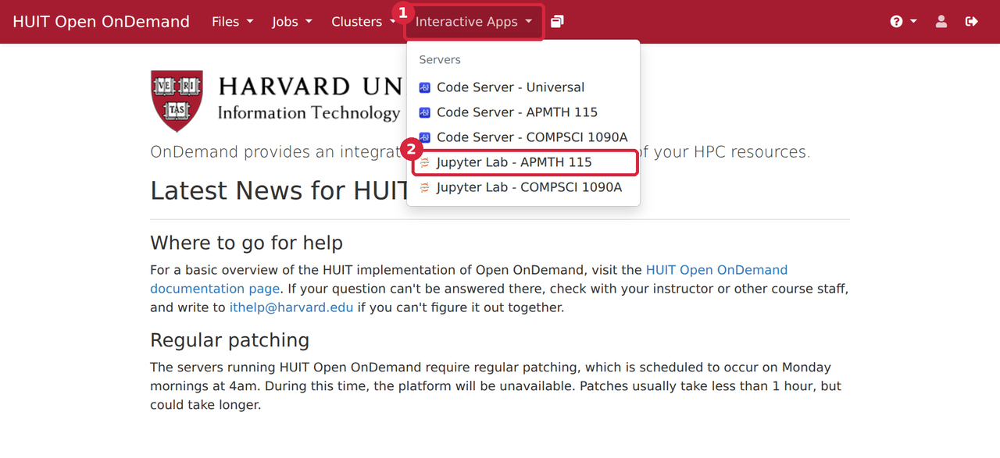
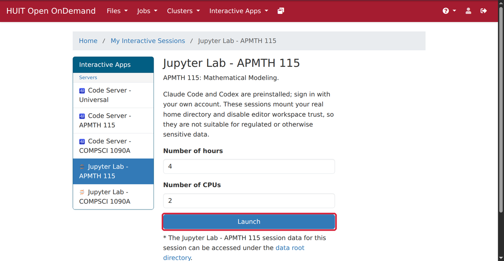
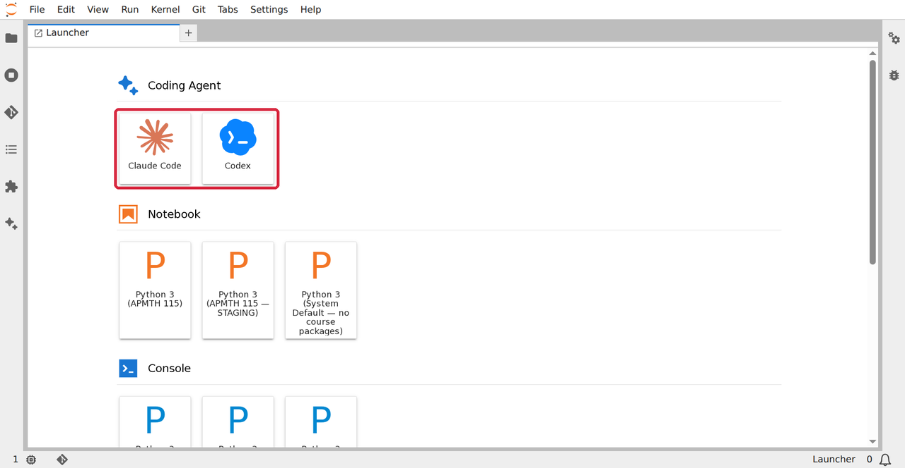
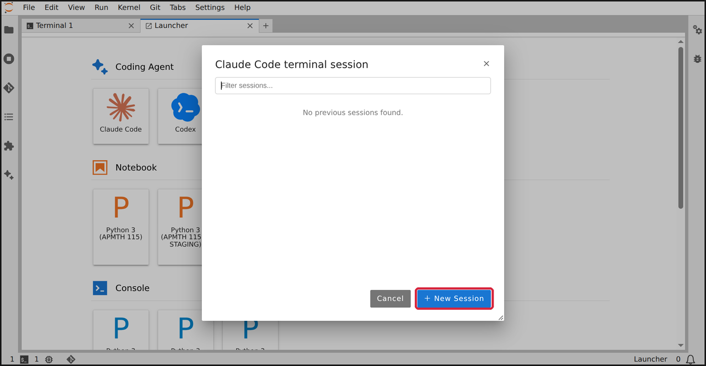
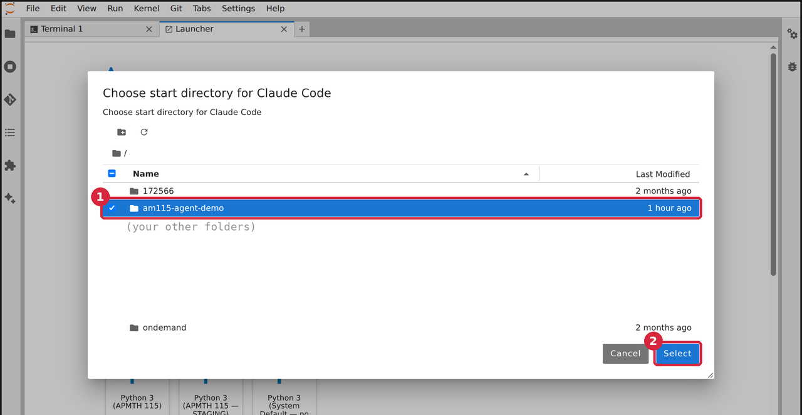
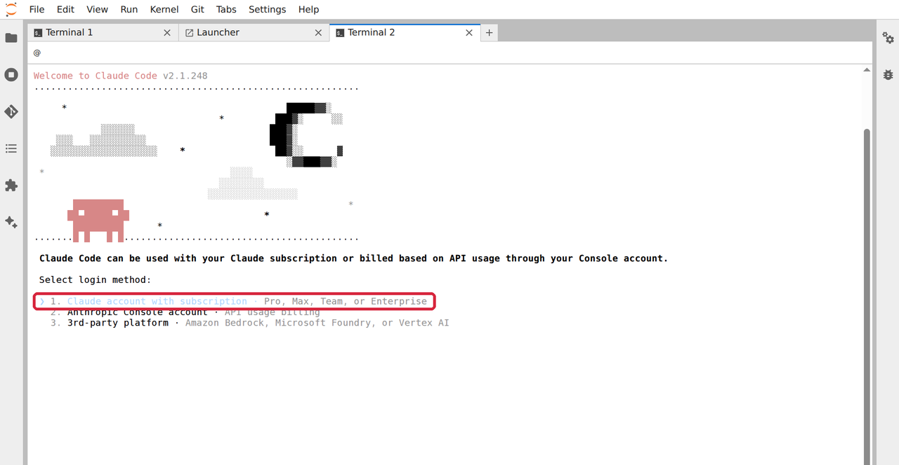
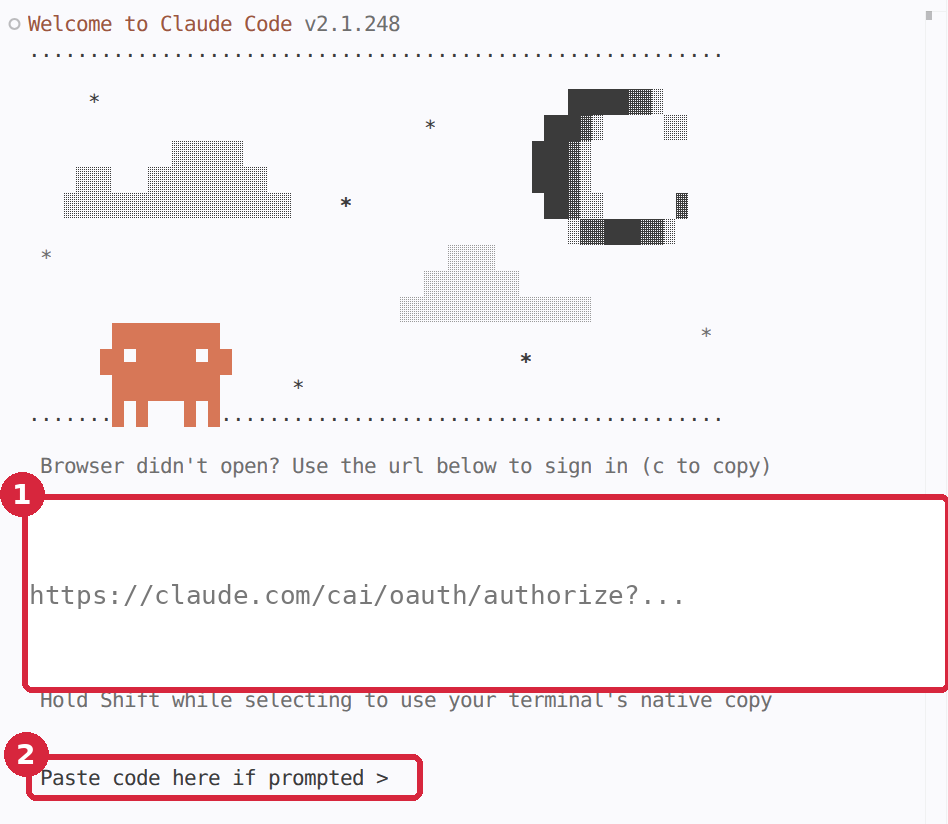
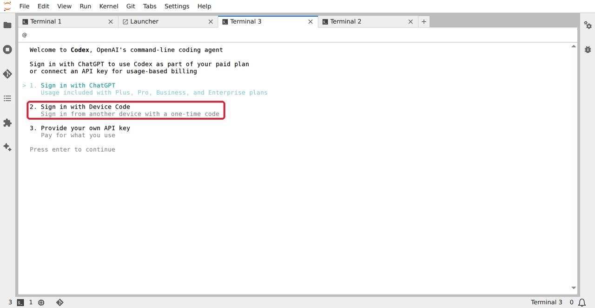
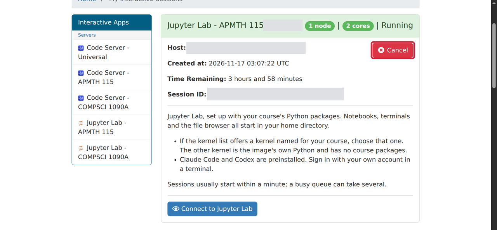

# AM115 cluster quickstart

> This guide takes you from the Harvard Open OnDemand website to a coding agent (Claude Code or Codex) running on a course compute node, in your own project folder.

The course cluster is a group of shared computers that Harvard runs for several courses, including this one. You reach it through a website called **Open OnDemand**. From there you start a **session**: a JupyterLab window that runs on one of the cluster's compute nodes and holds a fixed number of CPUs and memory for the hours you ask for. Claude Code and Codex are already installed in that session. You only have to start one and sign in.

You need:

- your HarvardKey;
- an account for the agent you want to use. Claude Code needs a Claude account with a subscription (its sign-in screen lists Pro, Max, Team or Enterprise). Codex needs a ChatGPT plan that includes Codex. The cluster provides the programs, not the accounts.
- your project files, if you have them. If they are not on the cluster yet, you can start without them and add them later ([Getting your files onto the cluster](git.md)).

The pictures below come from an instructor account, so your menus may list fewer apps. Identifiers such as job numbers, and the names of other people's folders, are blanked out.

## 1. Open the Jupyter Lab app

Go to **<https://ood.huit.harvard.edu>** and sign in with your HarvardKey. Open the **Interactive Apps** menu (1) and choose **Jupyter Lab - APMTH 115** (2).



## 2. Launch a session

The form asks for two numbers. **Number of hours** is how long the session lasts before the cluster stops it; **Number of CPUs** is how many processors it holds for you. The defaults, 4 hours and 2 CPUs, are a good first choice. Click **Launch**.



You land on **My Interactive Sessions**, where your session appears as a card. It shows **Starting** while the cluster finds a compute node for you, then **Running**. In our tests this took about 30 seconds; when many people are using the cluster it can take several minutes.

## 3. Connect to the session

When the card says **Running**, click **Connect to Jupyter Lab**. JupyterLab opens in a new browser tab.


## 4. Start the agent in your project folder

The JupyterLab **Launcher** tab has a **Coding Agent** section with two tiles. Click **Claude Code** or **Codex**. (If you do not see the Launcher, click the **+** at the right end of the row of tabs.) If the tiles do not work for you, you can start the agent from a terminal instead; see [More about the JupyterLab session](jupyter.md#open-a-terminal).



Claude Code first shows a window titled **Claude Code terminal session**, which lists your earlier conversations. The first time, the list is empty: click **New Session**. Codex skips this window.



Both agents then ask for a **start directory**, the folder the agent works in. The list starts in your home folder, shown as **/**. Click your project folder once to select it (1), then click **Select** (2). The agent can read and change the files in this folder and in the folders inside it, so choose the project folder rather than your whole home folder. If you do not have a project folder yet, the folder icon with a **+** at the top of this window makes a new one.



The agent opens in a new terminal tab inside JupyterLab.

## 5. Sign in (first time only)

**Claude Code** first asks you to pick a text style; press **Enter** to accept the default. Next it asks for a login method. Choose **1. Claude account with subscription** and press **Enter**.



Claude Code then prints a long sign-in link (1) and waits at **Paste code here if prompted** (2). Open the link in your browser by clicking it; if clicking does nothing, press **c** to copy it and paste it into a new browser tab. Sign in on the page that opens. The page should then show a code: copy it, come back to the terminal, paste it at the prompt, and press **Enter**. If the page does something else, ask a TF.



**Codex** shows three sign-in options. Choose **2. Sign in with Device Code** with the arrow keys and press **Enter**. Codex should then print a web address and a short code: open the address in your browser, sign in, and type the code there.



The session stores your sign-in in your home folder, so later JupyterLab and VS Code sessions should not ask again. A session started from [Academic Shell Access](terminal.md) uses different agent settings and may ask you to sign in separately. If a sign-in step goes wrong, see [Troubleshooting](troubleshooting.md#signing-in).

## 6. Ask the agent to look before it changes anything

Copy this prompt into the agent and press **Enter**:

```text
I am an AM115 student working on the Harvard cluster.
Inspect this session and project without changing anything.
Tell me:
1. which directory I am in,
2. which Python environment is active,
3. what project files are present, and
4. the safest next step to run the project.
```

To answer, the agent runs commands such as `pwd` and `ls`. Before most commands, Claude Code stops and asks **Do you want to proceed?** Read the command first. Choose **1. Yes** when the command only looks at things. Choose **No** (the last option) if the command would change or delete files and you did not ask for that, or if you do not understand what it does; you can then ask the agent to explain it. Do not choose **Yes, and switch to auto mode**: the agent would then decide for itself which commands to run, without asking you first. If you use Codex, apply the same rule to any approval it asks you for.


A good answer names your folder, says that the course Python is the one in use (Python 3.13 with the course packages), lists your files, and suggests a next step. This is the answer we got for a folder with one small script. (These two pictures come from a session started in Academic Shell Access, so the top lines differ slightly from what you see in JupyterLab.)


The agent is a program running inside your session. It sees the same files you see, and anything it runs uses your session's CPUs and memory; it does not get extra computers of its own.

From here, ask the agent for help with your actual next step: running the project, fixing an error, or setting up something that is missing.

## 7. Stop the session when you finish

Your files are saved in your home folder and stay there after the session ends. Programs that are still running, including the agent, stop when the session stops. To quit Claude Code yourself, type `/exit`. Canceling the session, below, stops any agent that is still running. (Closing a JupyterLab terminal tab does not stop the program inside it.)

Go back to the **My Interactive Sessions** tab and click **Cancel** on your session's card. If the browser asks you to confirm, confirm. If you do not cancel, the session keeps its CPUs reserved until its hours run out.



## More help

- [Using VS Code instead of JupyterLab](vscode.md)
- [More about the JupyterLab session](jupyter.md): terminals, notebooks and kernels
- [Getting your files onto the cluster](git.md), including Git
- [How many hours and CPUs to ask for](resources.md)
- [Troubleshooting](troubleshooting.md)
- [Working from a plain terminal](terminal.md) with Academic Shell Access
- Advanced: [interactive shells with `srun`](advanced/interactive-shell.md) and [batch jobs](advanced/batch-jobs.md)
