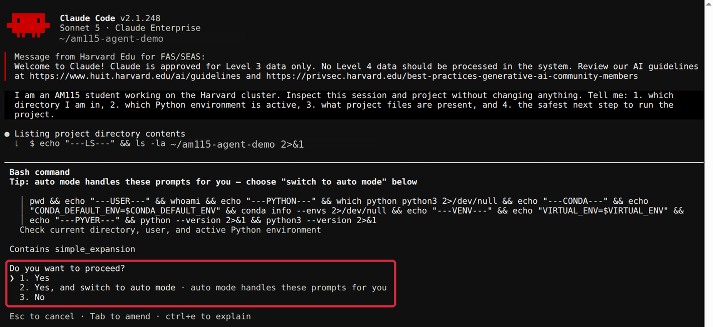
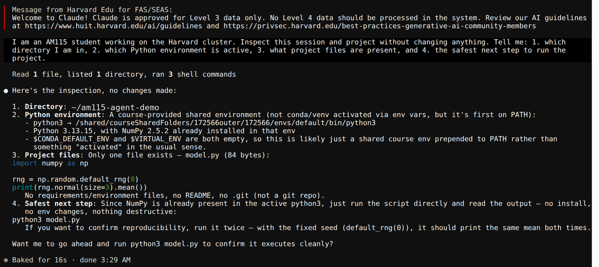

# AM115 cluster quickstart

> This guide takes you from the Harvard Open OnDemand website to a coding agent (Claude Code or Codex) running on a course compute node, in your own project folder.

The course cluster is a group of shared computers that Harvard runs for several courses, including this one. You reach it through a website called **Open OnDemand**. From there you start a **session**: an app such as JupyterLab or VS Code that runs on one of the cluster's compute nodes and holds a fixed number of CPUs and memory for the hours you ask for. Claude Code and Codex are already installed there. You only have to start one and sign in.

You need:

- your HarvardKey;
- an account for the agent you want to use. Claude Code needs a Claude account with a subscription (its sign-in screen lists Pro, Max, Team or Enterprise). Codex needs a ChatGPT plan that includes Codex. The cluster provides the programs, not the accounts.
- your project files, if you have them. If they are not on the cluster yet, you can start without them and add them later ([Getting your files onto the cluster](git.md)).

The pictures in this guide come from an instructor account, so your menus may list fewer apps. Identifiers such as job numbers, and the names of other people's folders, are blanked out.

## 1. Open Open OnDemand

Go to **<https://ood.huit.harvard.edu>** and sign in with your HarvardKey.

## 2. Choose where to work

There are three ways in. All three run on the same cluster, see the same home folder, and have the same course Python and agents, so you can switch between them later. Pick the one that matches how you like to work, follow its page until the agent is running, and then come back here for step 3.

- **[JupyterLab](jupyter.md)**: the notebook environment. Its Launcher has a **Claude Code** tile and a **Codex** tile that start an agent in the folder you pick. Choose this if you mostly work in notebooks.
- **[VS Code](vscode.md)**: the code editor, in your browser. Claude Code is built in as a panel: you click the Claude icon and type your request in a chat box. Choose this if you mostly edit `.py` files. Its Source Control panel commits and pushes to GitHub over HTTPS; Git with an SSH key does not work there (see [Getting your files onto the cluster](git.md)).
- **[Academic Shell Access](terminal.md)**: a plain terminal. You ask for a compute node yourself with one command, then start the agent from the command line. Choose this if you are comfortable with a terminal.

## 3. Sign in to the agent (first time only)

The first time you start an agent, it asks you to sign in.

**Claude Code in a terminal** (the JupyterLab tile, or Academic Shell Access) first asks you to pick a text style; press **Enter** to accept the default. Next it asks for a login method. Choose **1. Claude account with subscription** and press **Enter**.


Claude Code then prints a long sign-in link (1) and waits at **Paste code here if prompted** (2). Open the link in your browser by clicking it; if clicking does nothing, press **c** to copy it and paste it into a new browser tab. Sign in on the page that opens. The page should then show a code: copy it, come back to the terminal, paste it at the prompt, and press **Enter**. If the page does something else, ask a TF.


**Claude Code in the VS Code panel** may show its own sign-in screen instead. If it does, choose your Claude account and follow the steps it shows.

**Codex** shows three sign-in options. Choose **2. Sign in with Device Code** with the arrow keys and press **Enter**. Codex should then print a web address and a short code: open the address in your browser, sign in, and type the code there.


The agents store your sign-in in your home folder, so later JupyterLab and VS Code sessions should not ask again. Academic Shell Access uses different agent settings and may ask you to sign in separately. If a sign-in step goes wrong, see [Troubleshooting](troubleshooting.md#signing-in).

## 4. Ask the agent to look before it changes anything

Copy this prompt into the agent and send it:

```text
I am an AM115 student working on the Harvard cluster.
Inspect this session and project without changing anything.
Tell me:
1. which directory I am in,
2. which Python environment is active,
3. what project files are present, and
4. the safest next step to run the project.
```

To answer, the agent runs commands such as `pwd` and `ls`. Before most commands, Claude Code stops and asks for permission: **Do you want to proceed?** in a terminal, **Allow this bash command?** in the VS Code panel. Read the command first. Choose **Yes** when the command only looks at things. Choose **No** if the command would change or delete files and you did not ask for that, or if you do not understand what it does; you can then ask the agent to explain it. Do not choose an option that switches to **auto mode** or allows a command "for this project": the agent would then run those commands without asking you first. If you use Codex, apply the same rule to any approval it asks you for.



A good answer names your folder, says that the course Python is the one in use (Python 3.13 with the course packages), lists your files, and suggests a next step. This is the answer we got in Academic Shell Access for a folder with one small script:



Check the suggested next step against what you know about your session before you run it. When we asked the same question in VS Code, in a folder that also held a batch script, the agent suggested `sbatch`, a command that VS Code sessions do not have ([batch jobs](advanced/batch-jobs.md) are submitted from Academic Shell Access).

The agent is a program running inside your session. It sees the same files you see, and anything it runs uses your session's CPUs and memory; it does not get extra computers of its own.

From here, ask the agent for help with your actual next step: running the project, fixing an error, or setting up something that is missing.

## 5. Stop the session when you finish

Your files are saved in your home folder and stay there after the session ends. Programs that are still running, including the agent, stop when the session stops.

For JupyterLab and VS Code, go back to the **My Interactive Sessions** tab and click **Cancel** on your session's card. If the browser asks you to confirm, confirm. If you do not cancel, the session keeps its CPUs reserved until its hours run out. For Academic Shell Access, see [Leave cleanly](terminal.md#leave-cleanly).


## More help

- [Getting your files onto the cluster](git.md), including Git
- [How many hours and CPUs to ask for](resources.md)
- [Troubleshooting](troubleshooting.md)
- Advanced: [interactive shells with `srun`](advanced/interactive-shell.md) and [batch jobs](advanced/batch-jobs.md)

If a step in this guide does not match what you see, post on the course Ed forum or ask a TF.
