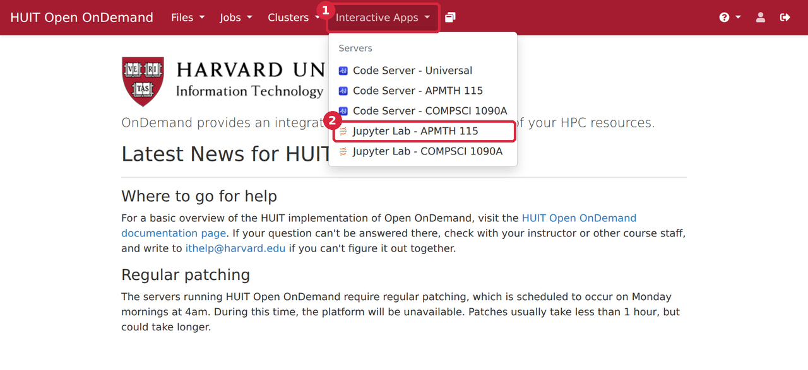
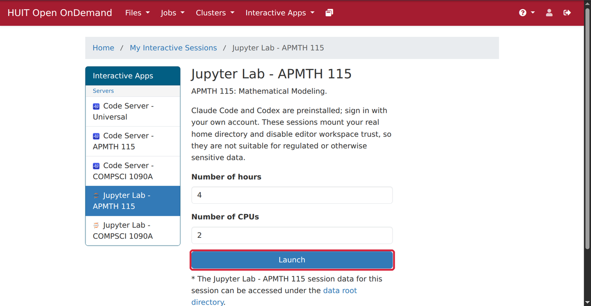
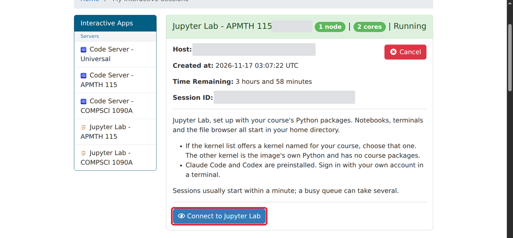
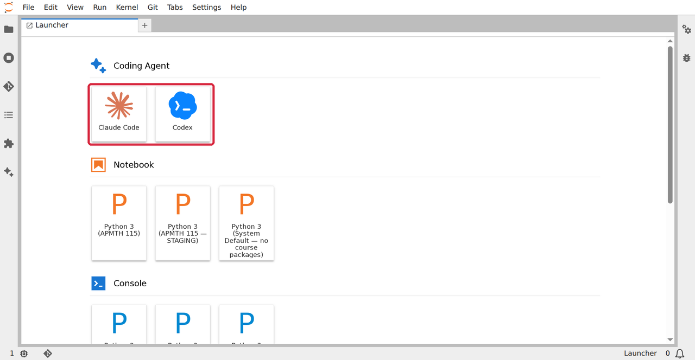
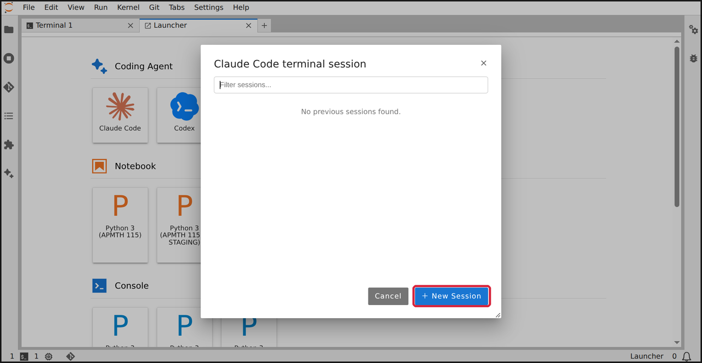
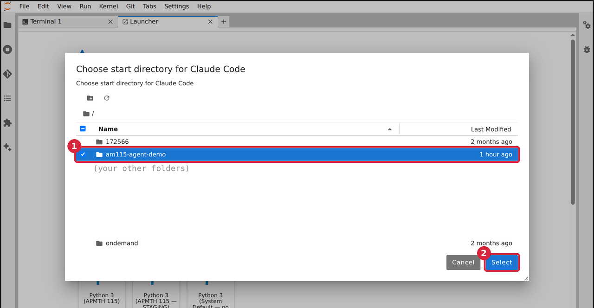
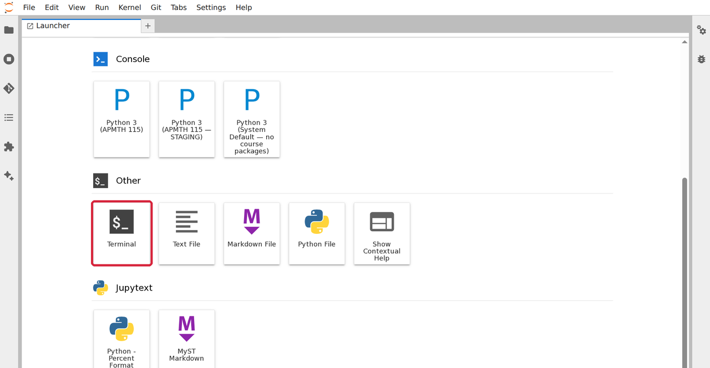

# Working in JupyterLab

The **Jupyter Lab - APMTH 115** app runs JupyterLab, the notebook environment, in your browser, on a course compute node. This page takes you from launching it to a running agent, then covers terminals, notebook kernels, and what is kept after the session ends.

[Back to the quickstart](README.md)

## Launch the session

On <https://ood.huit.harvard.edu>, open the **Interactive Apps** menu (1) and choose **Jupyter Lab - APMTH 115** (2).



The form asks for two numbers. **Number of hours** is how long the session lasts before the cluster stops it; **Number of CPUs** is how many processors it holds for you. The defaults, 4 hours and 2 CPUs, are a good first choice ([more about these numbers](resources.md)). Click **Launch**.



You land on **My Interactive Sessions**, where your session appears as a card. It shows **Starting** while the cluster prepares it, then **Running**. In our tests this took about 30 seconds; when many people are using the cluster it can take several minutes. When the card says **Running**, click **Connect to Jupyter Lab**. JupyterLab opens in a new browser tab.



## Start the agent in your project folder

The JupyterLab **Launcher** tab has a **Coding Agent** section with two tiles. Click **Claude Code** or **Codex**. (If you do not see the Launcher, click the **+** at the right end of the row of tabs.)



Claude Code first shows a window titled **Claude Code terminal session**, which lists your earlier conversations; click one to continue it. The first time, the list is empty: click **New Session**. Codex skips this window.



Both agents then ask for a **start directory**, the folder the agent works in. The list starts in your home folder, shown as **/**. Click your project folder once to select it (1), then click **Select** (2). The agent can read and change the files in this folder and in the folders inside it, so choose the project folder rather than your whole home folder. If you do not have a project folder yet, the folder icon with a **+** at the top of this window makes a new one.



The agent opens in a new terminal tab inside JupyterLab. Continue with [step 3 of the quickstart: Sign in to the agent](README.md#3-sign-in-to-the-agent-first-time-only).

## Open a terminal

A terminal lets you type commands, such as `git`, `uv` or `python`, on the compute node your session runs on. In the **Launcher**, scroll to the **Other** section and click **Terminal**.



The terminal starts in your home folder and already uses the course Python, so `python`, `uv`, `git`, `claude` and `codex` all work without any setup. To start an agent from the terminal instead of from its tile, move into your project folder and type its name:

```bash
cd ~/your-project-folder
claude
```

Replace `your-project-folder` with your folder's name. If you do not have a project folder yet, make one first with `mkdir ~/am115-project` and use that name. If `cd` prints `No such file or directory`, fix the name before you start the agent; otherwise the agent starts in your whole home folder.

## Choose the course kernel for notebooks

A **kernel** is the Python program that runs a notebook's cells. The Launcher's **Notebook** section offers several kernels. Choose **Python 3 (APMTH 115)**. It has the course packages, such as NumPy, SciPy and pandas. The kernel labeled **System Default — no course packages** is a bare Python, and course code that imports those packages fails there. If your account also shows a kernel marked **STAGING**, leave it alone; staff use it to test changes.

## What is kept and what is not

Your home folder is shared by every session and by Academic Shell Access. Files you save there are still there in your next session. The agents also save their sign-in there, which is why a later JupyterLab session should not ask you to sign in again.

Everything running stops when the session ends: notebooks' kernels, terminals and the agent. Closing a terminal's tab does not stop the program inside it; to stop a terminal, open the **Running Terminals and Kernels** panel (the circle with a square inside, in the left bar) and shut it down there. A long calculation that is still running when the hours run out is stopped partway. See [How many hours and CPUs to ask for](resources.md).

Which tabs were open in JupyterLab may not be restored in your next session, so save your work in files.

When you finish, [cancel the session](README.md#5-stop-the-session-when-you-finish).
