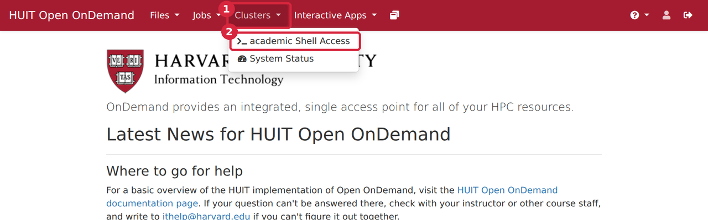
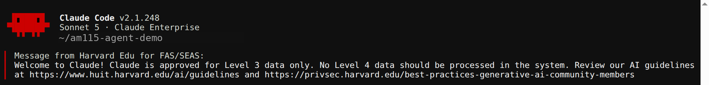

# Working from a plain terminal (Academic Shell Access)

**Academic Shell Access** opens a terminal in your browser on the cluster's **login node**: the shared computer you connect to first. Use it for small jobs: moving files, Git, and the scheduler commands in the [advanced pages](advanced/interactive-shell.md). Do not run an agent, a simulation or a package installation on the login node itself, because every other student shares it. Ask the scheduler for a compute node first, as shown below.

If you just want an agent, the [JupyterLab quickstart](README.md) is shorter.

## Open the shell

On <https://ood.huit.harvard.edu>, open **Clusters** (1) and choose **academic Shell Access** (2). The shell opens in a new tab.



The login node does not have `claude`, `codex` or `uv` on its own. Typing `claude` there gives `command not found`.

## Get a compute node, then start the agent

Ask the scheduler for an interactive session on a compute node. This command asks for 2 CPUs, 4 GB of memory and one hour:

```bash
srun --cpus-per-task=2 --mem=4G --time=01:00:00 --pty bash
```

When the prompt comes back, you are on a compute node. Move into your project folder and start Claude Code through the course launcher, which provides the course software:

```bash
cd ~/your-project-folder
~/172566/course-env claude
```

Replace `your-project-folder` with your folder's name. If you do not have a project folder yet, make one first with `mkdir ~/am115-project` and use that name. If `cd` prints `No such file or directory`, fix the name before you start the agent; otherwise the agent starts in your whole home folder.

Use `~/172566/course-env codex` for Codex. The first time, the agent asks you to sign in; follow [step 5 of the quickstart](README.md#5-sign-in-first-time-only). Running `~/172566/course-env` on its own gives you a shell with the course Python, `uv`, `claude` and `codex` all available.



## Leave cleanly

Quit the agent (type `/exit` in Claude Code), then type `exit` once to leave the compute node. The prompt returns to the login node and the compute node is released for someone else. Type `exit` again to close the shell.

[Back to the quickstart](README.md)
