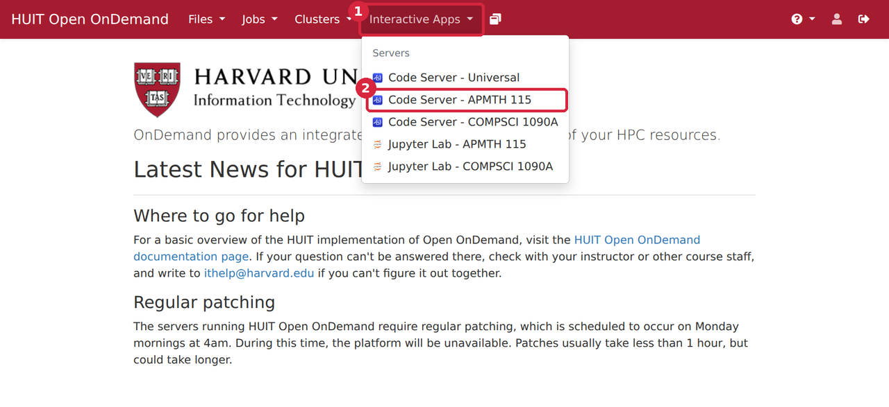
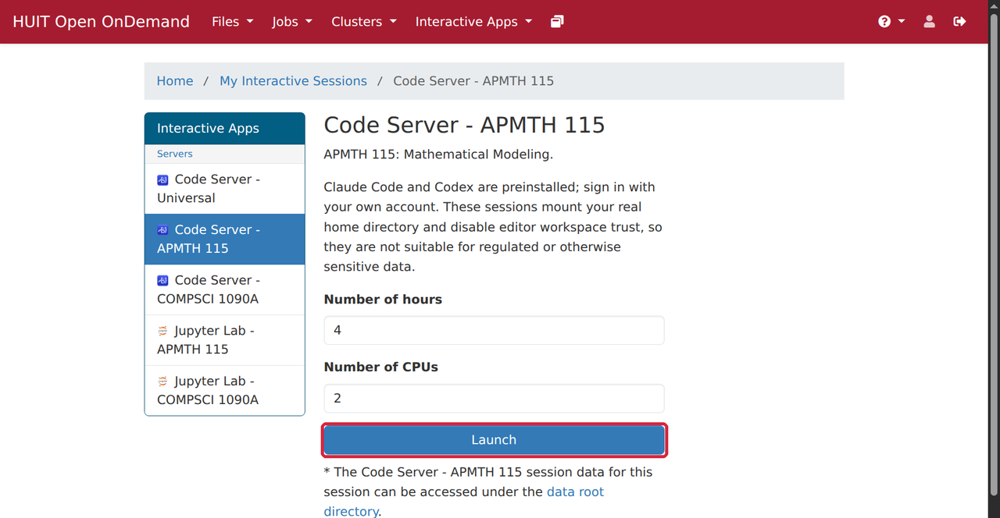
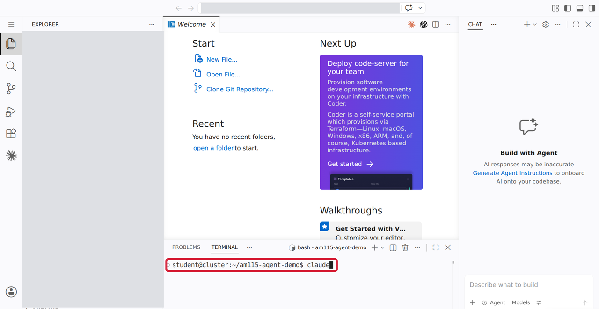
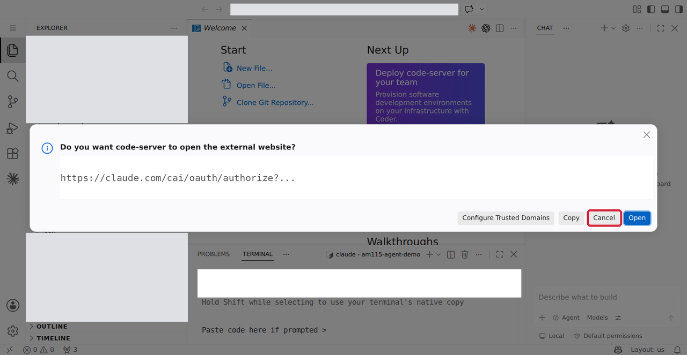

# Using VS Code instead of JupyterLab

The **Code Server - APMTH 115** app runs VS Code, the code editor, in your browser, on a course compute node. Use it if you prefer VS Code to JupyterLab. It has the same course Python, `uv`, Claude Code and Codex as the JupyterLab session.

It differs from JupyterLab in two ways that matter for this guide:

- There are no agent tiles. You start the agent by typing a command in a terminal.
- The VS Code session cannot use Git with an SSH key, because the program Git needs for SSH (`ssh`) is not installed in it. You can still download public repositories over HTTPS. To push to a private repository with an SSH key, use a JupyterLab terminal or Academic Shell Access instead; see [Getting your files onto the cluster](git.md).

[Back to the quickstart](README.md)

## Launch and connect

On <https://ood.huit.harvard.edu>, open **Interactive Apps** (1) and choose **Code Server - APMTH 115** (2).



The form is the same as the JupyterLab one: hours and CPUs, with defaults of 4 and 2. Click **Launch**.



When the card on **My Interactive Sessions** says **Running**, click **Connect to Code Server**. VS Code opens in a new tab, showing the files in your home folder.


## Open a terminal

Click the menu button at the top left (1), then **Terminal** (2), then **New Terminal** (3).


## Start the agent

The terminal opens in your home folder. Move into your project folder with `cd`, then type `claude` (or `codex`) and press **Enter**:

```bash
cd ~/your-project-folder
claude
```

Replace `your-project-folder` with your folder's name. If you do not have a project folder yet, make one first with `mkdir ~/am115-project` and use that name. If `cd` prints `No such file or directory`, fix the name before you start the agent; otherwise the agent starts in your whole home folder.



You do not need to activate an environment first. The terminal already uses the course Python.

## Sign in (first time only)

Signing in follows the same steps as in [the quickstart](README.md#5-sign-in-first-time-only), with one difference for Claude Code. After you choose the login method, VS Code shows a pop-up: **Do you want code-server to open the external website?** Click **Cancel**, and use the link that Claude Code prints in the terminal instead. (The pop-up's link is a different one, and we have not seen it complete a sign-in.)



To open the terminal's link, press **c** to copy it, and paste it into a new browser tab. Sign in; the page should then show a code. Copy the code, paste it into the terminal, and press **Enter**.

For Codex, choose **2. Sign in with Device Code** as in the quickstart.

## Other agent buttons

VS Code in this session also shows a Claude Code icon and a Codex icon at the top right of the editor, and a chat panel on the right. These are the agents' editor extensions. This guide does not cover them; the terminal method above is the one we tested.

## Stopping

Close the browser tab, then **Cancel** the session on **My Interactive Sessions**, as in [step 7 of the quickstart](README.md#7-stop-the-session-when-you-finish).
