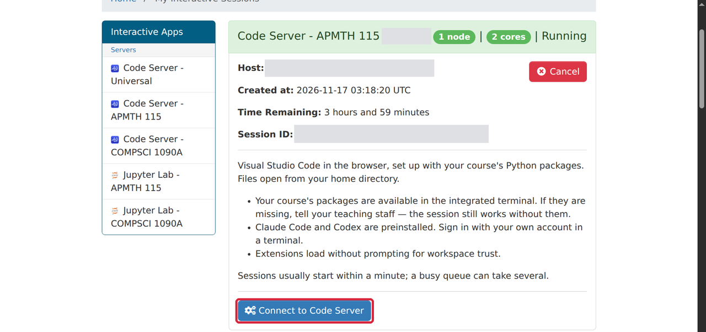
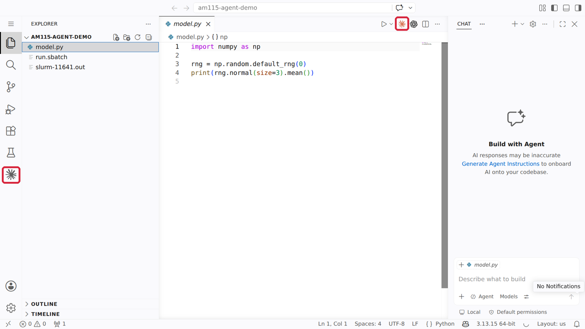
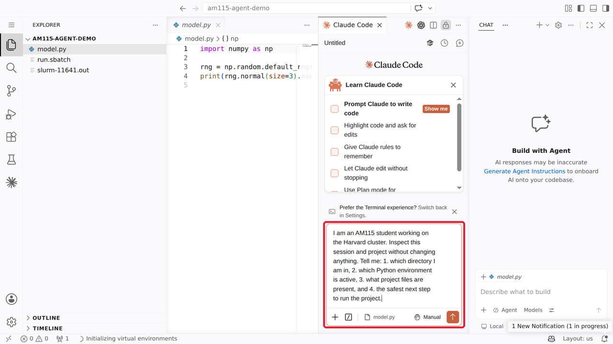
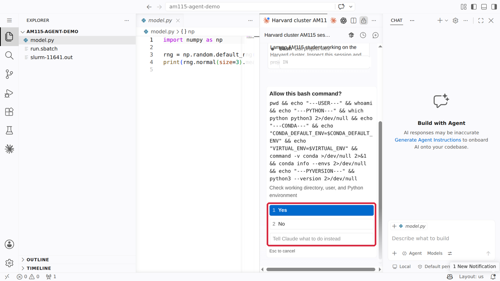
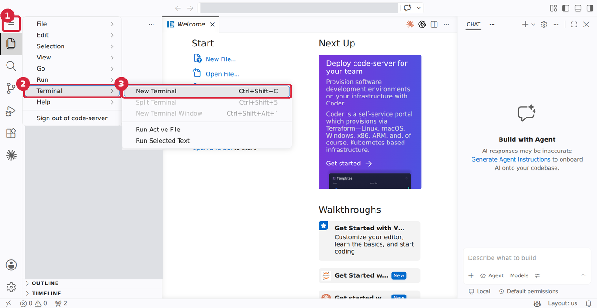

# Working in VS Code

The **Code Server - APMTH 115** app runs VS Code, the code editor, in your browser, on a course compute node. It has the course Python, `uv`, and both agents. Claude Code is built into VS Code as a panel, so you can work with it without opening a terminal.

Git works in VS Code: its **Source Control** panel commits, and pushes to GitHub over HTTPS after a GitHub sign-in that you repeat in each session ([Committing and pushing in VS Code](git.md#committing-and-pushing-in-vs-code)). What does not work is Git with an SSH key, because the `ssh` program is not installed in the VS Code session; use a JupyterLab terminal or Academic Shell Access for that.

[Back to the quickstart](README.md)

## Launch and connect

On <https://ood.huit.harvard.edu>, open **Interactive Apps** (1) and choose **Code Server - APMTH 115** (2).


The form asks for hours and CPUs, with defaults of 4 and 2 ([more about these numbers](resources.md)). Click **Launch**.


When the card on **My Interactive Sessions** says **Running**, click **Connect to Code Server**. VS Code opens in a new tab, showing the files in your home folder.



## Open your project folder

The agent works in the folder VS Code has open, so open your project folder rather than your whole home folder. Click the menu button at the top left (the three lines), choose **File**, then **Open Folder...**, pick your project folder, and click **OK**. The Explorer on the left then shows only that folder's files.

## Start Claude Code

Click the Claude icon, the orange starburst. It appears in two places: in the bar down the left edge, and at the top right of an open file. Either one opens Claude Code.



Claude Code opens as a panel beside your file. Type your request in the box at the bottom, **Ask Claude to edit…**, and press **Enter**. The file you have open is attached to the request, shown under the box.



Before Claude Code runs a command, it shows the command under **Allow this bash command?** with **Yes** and **No** buttons and a box to tell it what to do instead.



Continue with [step 3 of the quickstart: Sign in to the agent](README.md#3-sign-in-to-the-agent-first-time-only) if the panel asks you to sign in, or go straight to [step 4](README.md#4-ask-the-agent-to-look-before-it-changes-anything).

The OpenAI icon next to the Claude icon is Codex's panel. This guide covers Codex in a terminal instead, below.

## Run an agent in a terminal instead

You can also run `claude` or `codex` in VS Code's terminal, as in the other apps. Click the menu button at the top left (1), then **Terminal** (2), then **New Terminal** (3).



The terminal opens in the folder VS Code has open. If that is not your project folder, move into it with `cd`. Then type `claude` (or `codex`) and press **Enter**:

```bash
cd ~/your-project-folder
claude
```

Replace `your-project-folder` with your folder's name. If you do not have a project folder yet, make one first with `mkdir ~/am115-project` and use that name. If `cd` prints `No such file or directory`, fix the name before you start the agent; otherwise the agent starts in your whole home folder.


Signing in from a terminal follows [step 3 of the quickstart](README.md#3-sign-in-to-the-agent-first-time-only), with one difference for Claude Code. After you choose the login method, VS Code shows a pop-up: **Do you want code-server to open the external website?** Click **Cancel**, and use the link that Claude Code prints in the terminal instead. (The pop-up's link is a different one, and it may not work from your browser.)


To open the terminal's link, press **c** to copy it, and paste it into a new browser tab. Sign in; the page should then show a code. Copy the code, paste it into the terminal, and press **Enter**.

For Codex, choose **2. Sign in with Device Code** as in the quickstart.

## Stopping

Close the browser tab, then **Cancel** the session on **My Interactive Sessions**, as in [step 5 of the quickstart](README.md#5-stop-the-session-when-you-finish).
